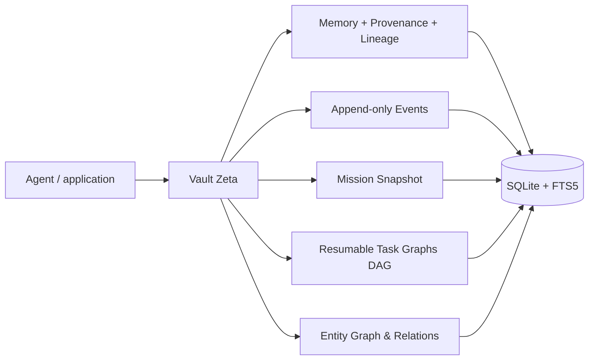

# Vault Zeta 🌠

Most AI systems are getting better at reasoning, but they still have a continuity problem.

Close the session, change the model, move to another machine, or come back a month later and a lot of useful context disappears. My interest in Vault Zeta started there.

**Vault Zeta is an experimental continuity layer for long-running AI systems.**

Not “infinite memory”. Not a magic brain dump. The goal is much more practical: keep useful state, where it came from, how confident we are in it, whether the source has changed, what evolved through corrections, what tasks compose long-running missions, and where to resume after a crash or process restart.

I sometimes call it **the daddy of the future** 😅🌠. The repository is where that joke has to survive contact with code.



The storage is intentionally boring right now. I want the continuity model to be understandable before making it distributed, embedded, or clever.

## What exists today

The current release (0.3.0) includes:

- SQLite-backed durable memory with zero external service dependencies
- Model Context Protocol (MCP) server for OpenCode, Claude Code, Cursor, and any MCP-compatible agent
- Directed acyclic task graph (DAG) primitives with cycle detection (`mission_tasks`, `mission_task_deps`)
- Automatic cascade unblocking of downstream dependent tasks
- Crash recovery and resumption plan builder (`recover_mission`, `mission_resumption_plan`)
- Deterministic event replay verification (`replay_events`, `mission_replay_events`)
- Idempotent mission event journal with `idempotency_key` deduplication
- Explicit memory supersession links (`supersedes_id`, `superseded_by`) and lineage tracking (`get_lineage`)
- Entity indexing and relationship tracking (`entities`, `memory_entities`)
- Explainable retrieval ranking with BM25 score, confidence weight, and recency breakdown (`search_explain`)
- Ground-truth retrieval evaluation and benchmarking harness (`eval.py`, MRR, Precision@K, Recall@K)
- Untrusted data boundary context packaging (`context_pack`) to prevent memory-based prompt injections
- Automatic secret and credential leak detection (`redact.py`) across content, metadata, payloads, and snapshots
- Portable directory bundle export (`bundle_export`) and deduplicated import (`bundle_import`) with v1.2.0 task graphs
- Durable mission snapshots with optimistic revision checks
- Thread-safe SQLite concurrency (`RLock`) for async multi-agent workloads
- Comprehensive test suite for persistence, continuity, lineage, task graphs, recovery, redaction, and MCP behavior

The important rule is:

> **Memory is context, not permission.**

Remembering that someone approved an action yesterday must never become authority to repeat that action today.

## Why this is separate from an agent

Vault Zeta is not meant to be another coding agent or chatbot.

Scrappy Forge can be one of the systems that *uses* continuity. CANOPY can eventually use it for long-running environmental missions. Other agents should be able to use the same layer without inheriting each other's authority.

That separation matters to me.

## Quick start

Requires Python 3.11+.

```bash
git clone https://github.com/getkcoin-alt/vault-zeta.git
cd vault-zeta

python3 -m venv .venv
source .venv/bin/activate
python -m pip install -e '.[dev]'

pytest
python examples/quickstart.py
```

Minimal usage:

```python
from vault_zeta import VaultZetaStore

with VaultZetaStore("zeta.db") as zeta:
    # 1. Durable memory with provenance
    memory = zeta.add_memory(
        kind="semantic",
        content="The greenhouse irrigation controller uses zone-level moisture targets.",
        scope="canopy/greenhouse",
        source="docs/irrigation.md",
        confidence=0.95,
    )

    # 2. Resumable task graph
    zeta.create_task(
        mission_id="mission-42",
        task_id="read_sensors",
        title="Sample soil moisture",
    )
    zeta.create_task(
        mission_id="mission-42",
        task_id="adjust_valves",
        title="Adjust irrigation valves",
        dependencies=["read_sensors"],
    )

    # 3. Crash recovery & resumption plan
    plan = zeta.recover_mission("mission-42")
    print("Ready to run:", plan.ready_task_ids)
```

## Model Context Protocol (MCP) Server

Vault Zeta can be mounted as an MCP server in any modern coding agent (OpenCode, Claude Code, Cursor, Antigravity).

Many agents come and go — our memory lasts forever.

### Run locally:

```bash
uv run --python 3.12 -m vault_zeta.mcp_server
```

Or configure in `opencode.json`:

```json
{
  "mcp": {
    "vault-zeta": {
      "enabled": true,
      "type": "local",
      "command": [
        "uv",
        "run",
        "--python",
        "3.12",
        "--with",
        "mcp>=1.0",
        "--directory",
        "/Users/karnveersingh/vault-zeta",
        "-m",
        "vault_zeta.mcp_server"
      ]
    }
  }
}
```

### Authenticated HTTP transport

Streamable HTTP and SSE require a private `VAULT_ZETA_HTTP_TOKEN` at startup. Generate a
random credential with at least 32 bytes of entropy, for example with Python's
`secrets.token_urlsafe(32)`, and supply it through your secret manager or process
environment. Configure the client to send `Authorization: Bearer <token>` on every
request. Use TLS for connections outside loopback. Stdio needs no HTTP credential.

The bearer credential grants access to the whole vault. Share it only with agents trusted
to read and modify that vault, and restart the server after rotating it. Clients must
support explicit bearer headers. This setup does not provide OAuth discovery or login.

### Read-only owner dashboard

The dashboard browses the existing SQLite vault through a read-only connection. It
shows memory search and correction history alongside mission snapshots, tasks, and
events. It uses a dedicated owner password and runs on loopback. For remote access,
serve `/dashboard/` through your HTTPS reverse proxy and use a private password file.

```bash
python -m vault_zeta.dashboard --db /path/to/vault.db \
  --username owner --password-file /path/to/private-dashboard-password
```

Set `--mcp-url https://vault.example.com/mcp` to show the hosted endpoint on the
dashboard’s Connect page. To enable copying authenticated configurations for Claude
Code, OpenCode, and Antigravity and a request header value for Claude's custom
connectors, also set `--mcp-token-file` to a private file containing the MCP server's
bearer credential. Serve the dashboard and MCP endpoint
from the same HTTPS origin so the dashboard can authorize clipboard requests. Copy
configurations only into private client settings because they grant vault access.
Use **Copy setup prompt** to ask a coding agent to configure the connection and
verify that it can discover Vault Zeta tools. The prompt includes the endpoint and
client-specific steps. Provide authentication through the client's private settings,
an environment variable, or a user-only token file.
ChatGPT custom apps require a compatible OAuth issuer for this protected endpoint.

### Available MCP Tools:

| Tool | Purpose |
|---|---|
| `memory_save` | Persist a durable fact with kind, scope, source, and confidence. Rejects secrets automatically. |
| `memory_supersede` | Correct/replace an obsolete memory with an explicit lineage link and reason. |
| `memory_lineage` | Retrieve full chronological chain of ancestors and replacements for a memory. |
| `memory_search` | FTS5 lexical search across stored memories with phrase and term scoring. |
| `memory_search_explain` | Search with explainable breakdown of BM25 score, confidence weight, and recency. |
| `memory_mark_stale` | Mark memories stale when their source file or document fingerprint changes. |
| `entity_link` | Link a memory to a named entity (technology, repo, policy, concept) with a relationship. |
| `entity_get_memories` | Retrieve all active memories referencing a given entity. |
| `context_pack` | Return recalled facts formatted safely within `<vault_memories>` prompt injection boundaries. |
| `task_create` | Create a task node in a mission's DAG with dependency and cycle validation. |
| `task_update` | Update task execution status with automatic cascade unblocking of downstream dependents. |
| `task_list` | List tasks for a mission, optionally filtered by status (pending, running, completed). |
| `mission_resumption_plan` | Build crash recovery and resumption plan after process crashes or restarts. |
| `mission_replay_events` | Replay mission events sequentially to verify state machine consistency. |
| `mission_compact` | Compact mission snapshots while preserving immutable event journals. |
| `memory_list` | Browse recent memories newest-first. |
| `memory_delete` | Remove a memory by UUID. |
| `vault_status` | Health, DB location, memory, entity, task, mission, and event counts. |
| `event_append` | Append an observation or step to a mission's journal with idempotency support. |
| `event_list` | Read ordered mission events. |
| `mission_save` | Save/update a mission snapshot with optimistic revision concurrency. |
| `mission_load` | Load a mission snapshot to resume execution. |
| `bundle_export` | Export vault into a portable directory bundle with entity and task DAG graphs. |
| `bundle_import` | Import and deduplicate a portable bundle directory without foreign key hazards. |

## What Vault Zeta is not

At this stage it is **not**:

- a vector database
- a consciousness claim
- an identity replacement mechanism
- an authorization system
- a distributed database
- a guaranteed truth store
- production-ready infrastructure

The current alpha gives us a clean place to test continuity mechanisms before adding more intelligence around them.

## Where this is going

The next useful steps are:

- multi-agent memory namespaces and scoped agent identities (Phase 3)
- cross-agent handoffs with explicit provenance tracking
- adapters for Scrappy Forge and CANOPY
- optional embedding adapters without making embeddings mandatory
- encryption options for sensitive local stores
- long-duration multi-agent simulations

See [ROADMAP.md](ROADMAP.md).

## Contributing

Contributions are welcome.

If this problem interests you, start with [CONTRIBUTING.md](CONTRIBUTING.md) and the open issues. I would especially like help from people interested in agent memory, databases, provenance, retrieval evaluation, distributed systems and safety boundaries.

Please do not submit real private memories, credentials, customer data or personal datasets as test fixtures.

## Related work

- Scrappy Forge: https://github.com/getkcoin-alt/scrappy_forge
- Scrappy OS: https://github.com/getkcoin-alt/-scrappy-os
- Karnveer: https://karnveer.com

---

Built around a simple belief: **intelligence without continuity keeps relearning the same life.**


## License

Apache License 2.0 — see [LICENSE](LICENSE).
